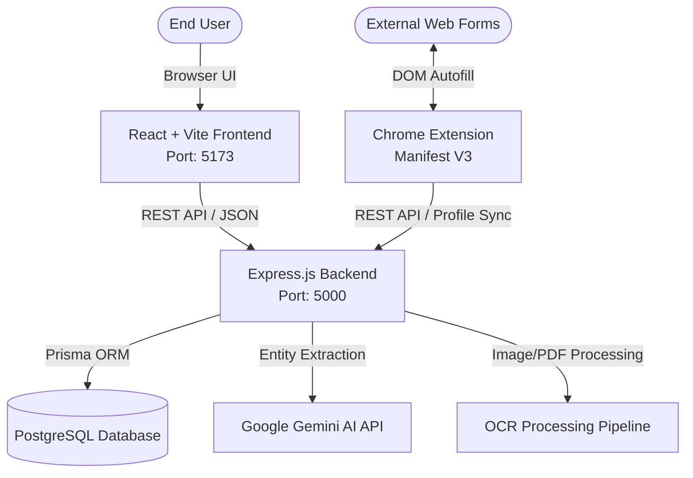

# VaaniFill AI - System Architecture

## High-Level Architecture Overview

VaaniFill AI is designed with a decoupled, modular architecture to empower a four-member hackathon team to work concurrently without merge conflicts.

## Subsystem Details

### 1. Frontend (`frontend/`)
- **Technology**: React 19 + Vite (JavaScript, Vanilla CSS tokens)
- **Role**: Delivers the welcome landing page, guest workflow, voice-assisted input, document upload, and interactive form correction screen.
- **State & Service**: Decoupled UI components consuming standard endpoints via `src/services/apiClient.js`.

### 2. Backend (`backend/`)
- **Technology**: Node.js, Express.js, Prisma ORM, PostgreSQL
- **Role**: Manages guest sessions, processes multipart document uploads, interfaces with Gemini API for semantic field matching, and persists data securely.

### 3. Chrome Extension (`extension/`)
- **Technology**: Manifest V3 (Vanilla JS, HTML, CSS)
- **Role**: Injected content scripts detect HTML form elements on third-party sites and autofill them from user-approved VaaniFill data.

### 4. Shared & Docs (`shared/`, `docs/`)
- **Role**: Single source of truth for API contracts, schema models, and development conventions.
